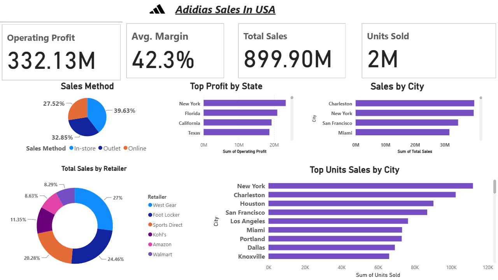

# Adidas Sales Analysis | Power BI Dashboard

## Project Overview

An interactive Power BI dashboard analyzing Adidas sales performance across the United States during 2020 and 2021.

The project focuses on sales, profitability, retailer performance, sales methods, and geographical trends.

## Business Objectives

- Monitor overall sales and profitability.
- Identify top-performing states and cities.
- Evaluate sales performance across retailers.
- Compare in-store, outlet, and online sales methods.
- Analyze units sold across different cities.

## Key Performance Indicators

| KPI | Value |
|---|---:|
| Total Sales | 899.90M |
| Operating Profit | 332.13M |
| Average Margin | 42.3% |
| Units Sold | Approximately 2M |

## Dashboard Preview

## Key Insights

- New York leads the displayed state-level operating profit ranking.
- Charleston and New York are leading cities by total sales.
- West Gear accounts for 27% of total retailer sales, followed by Foot Locker at 24.46%.
- In-store sales represent the largest segment in the sales method chart at 39.63%.
- New York leads the displayed city-level units sold ranking.

## Dashboard Features

- KPI cards for sales, profit, margin, and units sold.
- Operating profit by state.
- Total sales by city and retailer.
- Units sold by city.
- Sales method distribution.
- Interactive filters for year, month, product, and sales method.

## Tools and Technologies

- Microsoft Power BI
- Business Intelligence
- Data Visualization
- Retail Sales Analytics
- KPI Analysis

## Project File

[Download Power BI Dashboard](adidas.pbix)

Open the PBIX file using Microsoft Power BI Desktop.

## Author

Abdelrahman Omar | Data Analyst

[Portfolio](https://abdelrahman-omar-portfolio.lovable.app) |
[LinkedIn](https://www.linkedin.com/in/abdelrahman-omar-9370b8360/)
